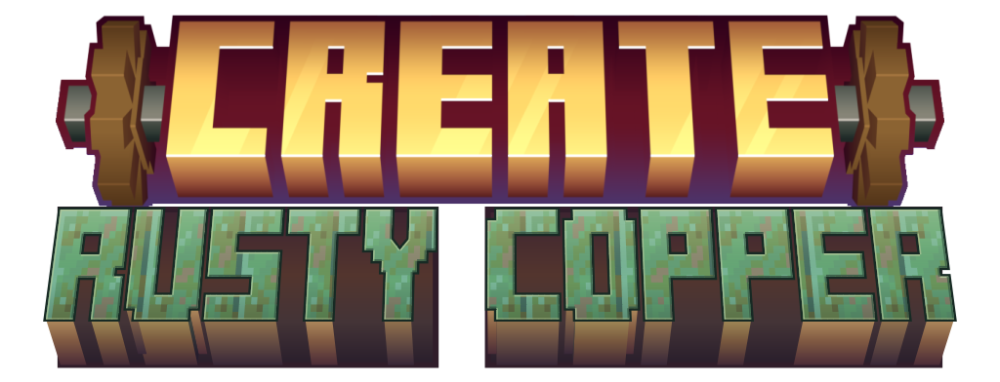

# Create: Rusty Copper

  

A [Create](https://github.com/Creators-of-Create/Create) addon bringing copper components and rust to your factory.

Build with copper, let it age, and keep your machinery in shape. The project is in development, with more copper content on the way.

## Requirements

| Dependency | Version |
| --- | --- |
| Minecraft | 1.21.1 |
| NeoForge | 21.1.219 or newer |
| Create | Newer than 6.0.0; built against 6.0.10 |

## Installation

Install NeoForge, Create, and its required dependencies, then place the addon jar in your `mods` folder. For multiplayer, install it on both the client and server.

## Development

Build with **Java 21** using `./gradlew build` (`gradlew.bat build` on Windows). The mod jar is written to `build/libs/`.

Feedback and bug reports are welcome in the [issue tracker](https://github.com/misaka19465/create_rusty_copper/issues).

## Credits and license

Original work is licensed under [MIT](LICENSE). See [CREDITS.md](CREDITS.md) for asset attribution and third-party licenses.
